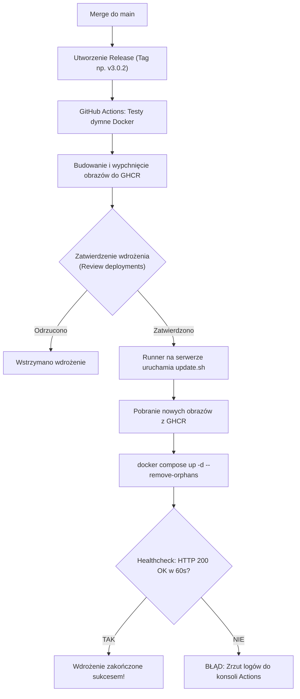

# Przewodnik Przepływu Pracy (Git, CI/CD i Wdrożenia)

> **Dla kogo jest ten dokument:**  
> Ten przewodnik jest skierowany do praktykantów i młodszych programistów dołączających do zespołu Louez. Opisuje krok po kroku pełny cykl życia kodu — od pomysłu i stworzenia gałęzi, przez weryfikację jakości, aż po wydanie i wdrożenie na serwer produkcyjny.
>
> Nawet jeśli znasz polecenia Gita i Dockera z uczelni czy kursów, w projekcie komercyjnym łatwo o wpadkę (np. przypadkowy push na `main`, utratę kodu przy rozwiązywaniu konfliktów czy zepsucie CI). Ten dokument nauczy Cię dobrych nawyków i pokaże, jak radzić sobie z problemami bez stresu.
> **Każda sekcja zawiera gotowe do skopiowania komendy wraz z opisem, co dokładnie robią.**

---

## Spis Treści

1. [Złote Zasady (Primum non nocere)](#1-złote-zasady)
2. [Krok 1: Start nowego zadania (Tworzenie gałęzi)](#2-krok-1-start-nowego-zadania)
3. [Krok 2: Praca lokalna i commity](#3-krok-2-praca-lokalna-i-commity)
4. [Krok 3: Lokalna weryfikacja przed pushem (Bramki jakości)](#4-krok-3-lokalna-weryfikacja-przed-pushem)
5. [Krok 4: Pull Request i Code Review](#5-krok-4-pull-request-i-code-review)
6. [Praca Równoległa w Zespole (Multi-Developer Workflow)](#6-praca-równoległa-w-zespole-multi-developer-workflow)
7. [Typowe Wpadki i Rozwiązania (FAQ Awaryjne)](#7-typowe-wpadki-i-rozwiązania)
   - [Wpadka A: Przypadkowo zrobiłem zmiany na `main`](#wpadka-a-przypadkowo-zrobiłem-zmiany-na-main)
   - [Wpadka B: Konflikty przy łączeniu (Merge Conflicts)](#wpadka-b-konflikty-przy-łączeniu-merge-conflicts)
   - [Wpadka C: Czerwone CI na GitHubie (TypeScript / Linter)](#wpadka-c-czerwone-ci-na-githubie)
8. [Krok 5: Merge do gałęzi głównej](#8-krok-5-merge-do-gałęzi-głównej)
9. [Krok 6: Wdrożenie na Produkcję (CD & Release)](#9-krok-6-wdrożenie-na-produkcję)
10. [Ściągawka dla Programisty (Quick Reference)](#10-ściągawka-dla-programisty)

---

## 1. Złote Zasady

Zanim wpiszesz jakiekolwiek polecenie w terminalu, zapamiętaj te 4 zasady:

1. **`main` jest święty.**  
   Gałąź `main` odzwierciedla działający, przetestowany kod. **Nigdy nie pracujemy bezpośrednio na `main`** i nigdy nie wypychamy do niego zmian z pominięciem Pull Requesta.
2. **Lokalny komputer sprawdza kod, GitHub Actions go tylko zatwierdza.**  
   Nie traktuj GitHuba jako darmowego lintera. Zanim zrobisz `git push`, musisz uruchomić testy formatowania, lintera i typów u siebie na komputerze.
3. **Nie bój się pytać i nie ukrywaj błędów.**  
   Każdemu zdarza się pomylić gałęzie lub zepsuć rebase. W Git prawie wszystko da się cofnąć i naprawić, o ile nie zaczniesz chaotycznie wpisywać poleceń z flagą `--force`.
4. **Zawsze aktualizuj `main` przed rozpoczęciem pracy.**  
   Rozpoczynanie pracy od nieaktualnego kodu to gwarancja męczących konfliktów przy mergowaniu.

### Komendy kontrolne (zanim zaczniesz cokolwiek robić):

```bash
# Pokazuje nazwę gałęzi, na której aktualnie się znajdujesz (upewnij się, że to NIE jest main podczas pisania kodu)
git branch --show-current

# Pokazuje stan katalogu roboczego: zmienione, dodane do poczekalni (staged) oraz nieśledzone pliki
git status

# Wyświetla 5 ostatnich commitów w zwięzłym, jednowierszowym formacie wraz z informacją o gałęziach i tagach
git log --oneline --decorate -n 5
```

---

## 2. Krok 1: Start nowego zadania

Zawsze zaczynaj od zaktualizowania lokalnego `main` do najświeższego stanu z serwera, a dopiero potem twórz nową gałąź:

```bash
# 1. Przełącza Twój katalog roboczy na główną gałąź repozytorium (main)
git checkout main

# 2. Pobiera najnowsze commity ze zdalnego serwera (origin) i aktualizuje Twój lokalny main
git pull origin main

# 3. Tworzy nową gałąź funkcyjną (flaga -b) na bazie świeżego maina i od razu na nią przełącza
git checkout -b feat/add-reservation-delete-modal

# 4. (Opcjonalnie) Wyświetla listę wszystkich lokalnych gałęzi i podświetla tę, na której teraz pracujesz
git branch
```

### Konwencja nazewnictwa gałęzi:

Nazwa gałęzi powinna mówić, czym jest zmiana:

- `feat/add-reservation-delete-modal` — nowa funkcjonalność dla użytkownika.
- `fix/negotiable-price-display` — naprawa błędu.
- `refactor/clean-customer-dialog-types` — poprawa struktury kodu bez zmiany działania.
- `chore/update-pnpm-lock` — zadania porządkowe, konfiguracja, biblioteki.

---

## 3. Krok 2: Praca lokalna i commity

Gdy piszesz kod, twórz commity regularnie — po ukończeniu małych, logicznych całości. Lepiej mieć 4 małe, czytelne commity niż 1 gigantyczny z opisem _"changes"_.

### Format wiadomości commitów (Conventional Commits):

Stosujemy format: `<typ>(<zakres>): <opis w trybie rozkazującym po angielsku>`

Przykłady:

- `feat(reservations): add confirmation step to delete action`
- `fix(storefront): prevent price flickers on negotiable items`
- `style: auto-fix formatting with oxfmt`
- `fix(lint): remove unused imports in customer-form`

### Komendy do codziennej pracy z commitami:

```bash
# 1. Sprawdza, które pliki zostały zmodyfikowane, usunięte lub nowo utworzone
git status

# 2. Pokazuje dokładne różnice (dodane i usunięte linie kodu) w plikach jeszcze niedodanych do poczekalni (unstaged)
git diff

# 3. Dodaje konkretny zmodyfikowany plik do poczekalni (staging area) przed commitem
git add apps/web/components/dashboard/customer-create-dialog.tsx

# 4. (Alternatywnie) Dodaje wszystkie zmodyfikowane i nowe pliki z całego repozytorium do poczekalni
git add -A

# 5. Pokazuje zmiany, które znajdują się już w poczekalni (staged) i wejdą do najbliższego commita
git diff --staged

# 6. Tworzy nowy commit z dodanych zmian wraz z czytelnym opisem zgodnym z Conventional Commits
git commit -m "fix(dashboard): correct CustomerType import in create dialog"

# 7. (Opcjonalnie) Pozwala poprawić opis ostatniego commita lub dorzucić do niego zapomniany plik (tylko przed git push!)
git commit --amend -m "fix(dashboard): correct CustomerType import and props in create dialog"
```

---

## 4. Krok 3: Lokalna weryfikacja przed pushem

Nasz monorepo posiada **3 bramki jakości** (oraz testy spójności migracji bazy danych). Wszystkie muszą przejść bez ani jednego błędu, zanim wypchniesz gałąź na GitHuba:

```bash
# BRAMKA 1: Sprawdza, czy wszystkie pliki są poprawnie sformatowane (Oxfmt) — nic nie zmienia w plikach
pnpm format:check

# Automatycznie formatuje wszystkie pliki w repozytorium (uruchom, jeśli format:check zgłosił błędy)
pnpm format

# BRAMKA 2: Uruchamia szybki linter (Oxlint) oraz skrypt wykrywający zduplikowane pliki w projekcie
pnpm lint

# BRAMKA 3: Weryfikuje poprawność typów TypeScript we wszystkich aplikacjach i pakietach monorepo
pnpm type-check

# BRAMKA 4 (gdy edytowałeś bazę danych / schema.ts): Sprawdza spójność schematu Drizzle z migracjami SQL
pnpm --filter @louez/db test
```

> [!TIP]
> Jeśli chcesz uruchomić wszystkie trzy główne bramki jakości (`format:check` + `lint` + `type-check`) jednym poleceniem, skopiuj i uruchom:
>
> ```bash
> # Uruchamia pełną lokalną walidację repozytorium (formatowanie, linter oraz TypeScript)
> pnpm check
> ```
>
> Jeśli `pnpm check` kończy się kodem `0`, Twój kod jest gotowy do wysłania.

---

## 5. Krok 4: Pull Request i Code Review

### 1. Wypchnięcie kodu na GitHuba

```bash
# Wysyła Twoją nową gałąź na GitHuba i wiąże ją ze zdalnym odpowiednikiem (flaga -u / --set-upstream — wymagana przy pierwszym pushu)
git push -u origin feat/add-reservation-delete-modal

# Przy każdym kolejnym pushu na tej samej gałęzi wystarczy już samo:
git push
```

### 2. Otwarcie Pull Requesta (PR)

Możesz utworzyć Pull Request w przeglądarce lub bezpośrednio z terminala za pomocą GitHub CLI (`gh`):

```bash
# Tworzy nowy Pull Request do gałęzi main bezpośrednio z terminala (interaktywnie zapyta o tytuł i opis)
gh pr create --base main

# Tworzy Pull Request z podanym tytułem i opisem bez wychodzenia z terminala
gh pr create --base main --title "feat(reservations): add delete confirmation modal" --body "Opis zmian i kroki testowe..."

# Otwiera aktualny Pull Request powiązany z Twoją gałęzią bezpośrednio w przeglądarce
gh pr view --web
```

**Tworzenie PR przez przeglądarkę krok po kroku:**

1. Wejdź na [GitHubie do repozytorium Louez](https://github.com/eNStudios-Rental/Louez).
2. Na samej górze pojawi się żółty pasek: **"Compare & pull request"** — kliknij go.
3. Wypełnij tytuł i opis PR:
   - **Co zostało zrobione:** krótkie podsumowanie wprowadzonych zmian.
   - **Jak to przetestować:** kroki dla testera lub drugiego programisty, aby sprawdzić zachowanie w aplikacji.
4. Upewnij się, że jako gałąź docelową (base branch) wybrano **`main`**.
5. Kliknij **Create pull request**.

### 3. Weryfikacja automatyczna (GitHub Actions CI)

Po utworzeniu PR GitHub uruchamia workflow `.github/workflows/ci.yml`.
Sprawdza on dokładnie te same rzeczy, które uruchamiałeś lokalnie (`format:check`, `lint`, `type-check`).

```bash
# Pokazuje w terminalu aktualny status testów CI (GitHub Actions) dla Twojego Pull Requesta
gh pr checks

# Obserwuje na żywo przebieg testów CI w terminalu aż do ich zakończenia
gh pr checks --watch

# Wyświetla logi z ostatniego nieudanego przebiegu GitHub Actions (gdy CI zaświeci się na czerwono)
gh run view --log-failed
```

- Jeśli widzisz **zielony znaczek (All checks have passed)** — świetna robota!
- Jeśli widzisz **czerwony krzyżyk** — kliknij _Details_ (lub użyj `gh run view --log-failed`), przeczytaj błąd i popraw go lokalnie (zobacz sekcję [Typowe Wpadki](#wpadka-c-czerwone-ci-na-githubie)).

---

## 6. Praca Równoległa w Zespole (Multi-Developer Workflow)

W projekcie komercyjnym rzadko pracujesz sam. Zazwyczaj kilku programistów jednocześnie modyfikuje kod w różnych (lub tych samych) gałęziach. Oto jak pracować płynnie w zespole i uniknąć chaosu:

### 1. Równoległa praca na osobnych gałęziach (Feature A i Feature B)

Wyobraź sobie sytuację:

- Ty pracujesz nad `feat/export-pdf-reports`.
- Kolega w tym samym czasie skończył `feat/delete-reservation` i jego kod został połączony z `main`.
- Twój branch w tym momencie stał się **nieaktualny** względem `main`.

**Dobra praktyka:** Regularnie (np. codziennie rano lub po merge'u kolegi) dociągaj świeży `main` do swojej gałęzi:

```bash
# 1. Pobiera informacje o najnowszych zmianach ze zdalnego serwera GitHub bez modyfikowania Twoich plików
git fetch origin

# 2. Łączy najnowszy stan zdalnej gałęzi main (origin/main) z Twoją aktualną gałęzią roboczą
git merge origin/main

# 3. Wypycha zaktualizowaną gałąź na GitHuba
git push
```

Dzięki temu ewentualne konflikty rozwiązujesz na bieżąco (gdy różnice są małe), a nie w dniu zgłoszenia PR, gdy zmian na `main` nazbierało się już kilkadziesiąt.

### 2. Wspólna praca dwóch osób na TEJ SAMEJ gałęzi (Pair programming / wspólne zadanie)

Gdy pracujesz z kimś nad tą samą gałęzią `feat/wspolne-zadanie`:

- Kolega zrobił commit i wypchnął go na GitHuba (`git push`).
- Ty lokalnie też napisałeś kod i wpisujesz `git push`.
- Git wyrzuca błąd: `[rejected - non-fast-forward]`.

> [!CAUTION]
> **NIGDY nie używaj `git push --force`!**  
> Użycie `--force` nadpisze i **bezpowrotnie skasuje** commity Twojego kolegi ze zdalnego GitHuba!

**Prawidłowe rozwiązanie:**

```bash
# 1. Pobiera nowe commity kolegi ze zdalnej gałęzi i układa Twoje lokalne commity na samym wierzchu historii
git pull --rebase origin feat/wspolne-zadanie

# 2. (Tylko jeśli wystąpiły konflikty) Po ręcznym poprawieniu plików w IDE oznacza konflikty jako rozwiązane
git add -A

# 3. (Tylko jeśli wystąpiły konflikty) Kontynuuje proces nakładania Twoich commitów po rozwiązaniu konfliktu
git rebase --continue

# 4. (Awaryjnie) Jeśli pogubiłeś się podczas rebase, przerywa operację i przywraca gałąź do stanu sprzed rebase
git rebase --abort

# 5. Bezpiecznie wypycha połączoną historię commitów na zdalną gałąź
git push origin feat/wspolne-zadanie
```

### 3. Konflikty w Bazie Danych (Drizzle ORM / Schemat)

Gdy dwóch programistów jednocześnie modyfikuje bazę danych w `packages/db/src/schema.ts` lub katalogu `packages/db/src/migrations/`:

1. Upewnij się po rozwiązaniu konfliktu w `schema.ts`, że nazwy wszystkich kolumn, tabel i indeksów są spójne, a numery migracji w `packages/db/src/migrations/meta/_journal.json` nie kolidują ze sobą.
2. Zweryfikuj schemat i migracje poniższymi komendami:

```bash
# 1. Generuje nowy plik migracji SQL na podstawie zmian w packages/db/src/schema.ts
pnpm db:generate

# 2. Uruchamia test jednostkowy sprawdzający 100% zgodność schema.ts z plikami SQL migracji oraz _journal.json
pnpm --filter @louez/db test

# 3. Wypycha aktualny schemat bezpośrednio do lokalnej bazy danych MySQL (przydatne podczas szybkiego prototypowania)
pnpm db:push

# 4. Wykonuje oczekujące migracje SQL na lokalnej bazie danych
pnpm db:migrate

# 5. Wypełnia lokalną bazę danych przykładowymi danymi demonstracyjnymi (sprawdza, czy seedery nie wywracają się na nowym schemacie)
pnpm db:seed:demo
```

### 4. Schowek Gita (`git stash`) — nagła zmiana kontekstu

Częsty scenariusz: pracujesz nad swoim kodem, masz nieskończone zmiany (kod się nie kompiluje), a lider prosi Cię: _"Sprawdź szybko błąd na main lub pomóż koledze na jego branchu"_.

Nie musisz robić brzydkiego commita z opisem _"wip"_. Użyj schowka:

```bash
# 1. Odkłada wszystkie niezacommitowane zmiany (również nowe, nieśledzone pliki dzięki -u) do bezpiecznego schowka z opisem
git stash push -u -m "WIP: niedokończony formularz zestawów"

# 2. Wyświetla listę wszystkich zapisanych stanów w schowku
git stash list

# 3. Twój katalog roboczy jest teraz czysty — przełączasz się na inną gałąź, aby pomóc koledze
git checkout main

# 4. Po zakończeniu wracasz na swoją gałąź funkcyjną
git checkout feat/moja-funkcja

# 5. Przywraca ostatnio schowane zmiany z powrotem do katalogu roboczego i usuwa je ze schowka
git stash pop
```

### 5. Draft Pull Request (WIP) i etykieta Code Review

- **Draft PR:** Jeśli zacząłeś duże zadanie, otwórz PR w trybie **Draft** (w rozwijanym menu przycisku _Create pull request_ wybierz _Create draft pull request_).
  - Informuje to zespół: _"Pracuję nad tym, nie duplikujcie mojej pracy"_.
  - Automatyczne CI w tle sprawdza Twój kod przy każdym pushu.
  - Nikt nie zrobi omyłkowego merge'a niedokończonego kodu.
- **Gotowość do recenzji:** Gdy skończysz i testy będą zielone, kliknij na GitHubie **Ready for review** i przypisz recenzentów (Reviewers).
- **Etykieta komentarzy:** Jeśli recenzent zostawił uwagę:
  - Odpowiedz na komentarz lub popraw kod.
  - **Nie klikaj "Resolve conversation"** bez wyjaśnienia ani poprawki w kodzie. Zostaw zamknięcie wątku recenzentowi, który go zgłosił.

```bash
# Tworzy Pull Request od razu w trybie roboczym (Draft PR) z poziomu terminala
gh pr create --base main --draft --title "WIP: feat(bundles): product bundles management" --body "Praca w toku..."

# Zmienia status Draft PR na gotowy do recenzji (Ready for review)
gh pr ready

# Po wprowadzeniu poprawek z Code Review: dodaje zmiany, tworzy czytelny commit i aktualizuje PR
git add -A && git commit -m "fix: address code review feedback" && git push
```

---

## 7. Typowe Wpadki i Rozwiązania

To jest sekcja, do której najczęściej będziesz wracać. Spokojnie — każdy z tych problemów da się rozwiązać w kilka minut.

---

### Wpadka A: Przypadkowo zrobiłem zmiany na `main`

**Objaw:** Napisałeś kod, zrobiłeś commity, po czym wpisujesz `git status` i widzisz: `On branch main`.

#### Sytuacja 1: Jeszcze NIE zrobiłeś `git push` (Twoje commity są tylko lokalnie)

To bardzo proste do naprawienia. Utworzymy nową gałąź z Twoimi zmianami, a lokalny `main` cofniemy do stanu z serwera:

```bash
# 1. Tworzy nową gałąź w miejscu, w którym teraz jesteś (wszystkie Twoje lokalne commity zostają zachowane na tej nowej gałęzi)
git branch feat/moja-funkcja

# 2. Pobiera aktualny stan zdalnego serwera, aby upewnić się, gdzie wskazuje origin/main
git fetch origin

# 3. Resetuje Twoją lokalną gałąź main dokładnie do stanu ze zdalnego GitHuba (origin/main)
git reset --hard origin/main

# 4. Przełącza Cię na utworzoną w kroku 1 gałąź funkcyjną — wszystkie Twoje commity tam czekają!
git checkout feat/moja-funkcja
```

#### Sytuacja 2: Przypadkowo zrobiłeś `git push` na `main`

Nigdy nie używaj `git push --force` na gałęzi `main`, bo możesz skasować pracę innych osób z zespołu!
Zamiast tego zgłoś to swojemu mentorowi / tech leadowi i bezpiecznie wycofaj niechciany commit nowym commitem odwracającym (`git revert`):

```bash
# 1. Zabezpiecza Twoje zmiany na osobnej gałęzi funkcyjnej, żebyś nie stracił napisanego kodu
git branch feat/moja-funkcja

# 2. Tworzy na gałęzi main nowy, bezpieczny commit odwracający zmiany z ostatniego commita (HEAD) bez przepisywania historii
git revert HEAD --no-edit

# 3. Wypycha commit odwracający na zdalny main — przywraca czystość gałęzi głównej
git push origin main

# 4. Przełącza Cię na Twoją gałąź funkcyjną, skąd możesz normalnie wystawić Pull Request
git checkout feat/moja-funkcja
```

---

### Wpadka B: Konflikty przy łączeniu (Merge Conflicts)

**Objaw:** W Twoim PR na GitHubie pojawia się szary komunikat:

> _"This branch has conflicts that must be resolved."_

> [!CAUTION]
> **Nie używaj przycisku "Resolve conflicts" w przeglądarce na GitHubie!**  
> Edytor webowy nie ma sprawdzania TypeScriptu ani formatowania. Kliknięcie _"Accept incoming"_ może przypadkowo wyciąć kod Twojego kolegi z zespołu lub pozostawić kod, który nie przejdzie kompilacji!

#### Jak rozwiązać konflikt poprawnie (Lokalnie w terminalu):

```bash
# 1. Upewnia się, że znajdujesz się na swojej gałęzi funkcyjnej
git checkout feat/moja-funkcja

# 2. Pobiera najświeższy stan wszystkich gałęzi z GitHuba (w tym origin/main)
git fetch origin

# 3. Rozpoczyna łączenie najnowszego maina (origin/main) z Twoją gałęzią
git merge origin/main

# 4. Pokazuje dokładną listę plików, w których wystąpił konflikt (oznaczonych jako "both modified")
git status

# (Awaryjnie) Jeśli chcesz przerwać merge i wrócić do stanu sprzed komendy git merge:
git merge --abort
```

Git poinformuje Cię, w których plikach wystąpił konflikt (zobaczysz `CONFLICT (content): Merge conflict in ...`).

5. Otwórz projekt w VS Code / swoim IDE:
   - Pliki z konfliktami będą oznaczone na czerwono.
   - Zobaczysz znaczniki:
     ```typescript
     <<<<<<< HEAD (Twoje zmiany z tej gałęzi)
     const customerName = `${customer.firstName} ${customer.lastName}`;
     =======
     const customerName = [customer.firstName, customer.lastName].filter(Boolean).join(" ");
     >>>>>>> origin/main (Zmiany z gałęzi głównej)
     ```
6. Przeanalizuj obie wersje:
   - Zazwyczaj celem jest **połączenie obu logik**, a nie bezmyślne usunięcie jednej z nich.
   - Usuń znaczniki `<<<<<<<`, `=======` i `>>>>>>>`.
7. **Kluczowy krok:** Uruchom lokalne testy, a następnie zacommituj i wypchnij rozwiązany konflikt:

```bash
# 1. Automatycznie formatuje kod po ręcznym łączeniu konfliktów
pnpm format

# 2. Sprawdza, czy podczas rozwiązywania konfliktu nie powstały duplikaty lub nieużywane importy
pnpm lint

# 3. Sprawdza, czy połączony kod kompiluje się bez błędów TypeScript
pnpm type-check

# 4. Oznacza wszystkie pliki z konfliktami jako rozwiązane
git add -A

# 5. Finalizuje merge commitem łączącym
git commit -m "chore: resolve merge conflicts with main"

# 6. Wypycha zaktualizowaną gałąź na GitHuba (konflikt w PR automatycznie zniknie)
git push origin feat/moja-funkcja
```

---

### Wpadka C: Czerwone CI na GitHubie

**Objaw:** W PR na GitHubie krok `validate` zakończył się błędem `Process completed with exit code 1`.

#### Jak to zdiagnozować i naprawić komendami:

```bash
# 1. Pobiera i wyświetla w terminalu dokładne logi błędów z ostatniego nieudanego CI na GitHubie
gh run view --log-failed

# 2. Odtwarza błąd lokalnie — sprawdza wszystkie bramki jakości (formatowanie, linter, typy)
pnpm check

# 3. Jeśli błąd dotyczył formatowania (Format issues found), naprawia go automatycznie:
pnpm format

# 4. Po naprawieniu błędów w kodzie: dodaje poprawki, tworzy commit i wysyła na GitHuba (CI uruchomi się ponownie)
git add -A && git commit -m "fix(ci): resolve lint and typecheck errors" && git push
```

#### Najczęstsze przyczyny błędów w logach:

1. **`error TS2304: Cannot find name 'XYZ'`**  
   Zapomniałeś zaimportować typu lub komponentu (np. `CustomerType`).
2. **`error TS2322: Type 'null' is not assignable to type 'undefined'`**  
   W TypeScript `null` i `undefined` to dwa różne typy. Użyj `?? undefined` lub popraw interfejs.
3. **`error TS1117: An object literal cannot have multiple properties with the same name`**  
   Klucz w obiekcie został zdefiniowany dwukrotnie (częsta pomyłka po merge konfliktów).
4. **`Format issues found`**  
   Zapomniałeś uruchomić `pnpm format` przed commitem. Uruchom `pnpm format`, zrób commit i wypchnij.

---

## 8. Krok 5: Merge do gałęzi głównej

Gdy spełnione są 3 warunki:

1. Wszystkie testy automatyczne w CI świecą na **zielono**.
2. Otrzymałeś zatwierdzenie (Approval) od mentora lub drugiego programisty.
3. Nie ma nierozwiązanych wątków dyskusji w zakładce _Files changed_.

Możesz połączyć kod z `main` (klikając zielony przycisk **Merge pull request** / **Squash and merge** na GitHubie oraz **Delete branch** lub używając poniższych komend), a następnie posprzątać lokalne gałęzie:

```bash
# 1. (Opcjonalnie z terminala) Łączy zaakceptowany PR z gałęzią main metodą Squash and Merge i automatycznie usuwa zdalną gałąź
gh pr merge --squash --delete-branch

# 2. Przełącza Twój lokalny katalog roboczy z powrotem na gałąź główną (main)
git checkout main

# 3. Pobiera najnowszy stan gałęzi main (zawierający już Twój świeżo zmergowany kod)
git pull origin main

# 4. Usuwa Twoją starą, zmergowaną już gałąź lokalną z komputera
git branch -d feat/moja-funkcja

# 5. Czyści lokalną listę zdalnych gałęzi, które zostały już usunięte na GitHubie
git fetch --prune
```

---

## 9. Krok 6: Wdrożenie na Produkcję

### Dlaczego sam merge do `main` nie wdraża od razu na serwer?

W środowisku produkcyjnym nie chcemy, aby każdy pojedynczy merge automatycznie restartował aplikację u klientów. Wdrożenia są **świadome i kontrolowane**:

- Wdrażamy paczki zmian w postaci **Wydania (Release / Tag)** o nazwie zaczynającej się od `v` (np. `v3.0.2`).
- Wypchnięcie tagu `v*` automatycznie uruchamia workflow [`.github/workflows/docker.yml`](file:///home/mpolak/Projects/Louez/.github/workflows/docker.yml) (**Build & Publish Docker Images**).
- Każde wdrożenie na serwer wymaga **ręcznego zatwierdzenia przez wyznaczoną osobę (Required Reviewer)**.

---

### Jak wygląda proces wdrożenia krok po kroku:



---

### 1. Przygotowanie i sprawdzenie numeru wersji przed utworzeniem Release:

Ustal numer wersji według reguł Semantic Versioning (`vMAJOR.MINOR.PATCH`):

- **PATCH** (np. `v3.0.1` -> `v3.0.2`): drobne poprawki błędów (bugfixes), małe korekty stylów.
- **MINOR** (np. `v3.0.2` -> `v3.1.0`): nowa funkcjonalność dla użytkownika wstecznie kompatybilna (np. nowy moduł, zestawy produktów, nowa integracja).
- **MAJOR** (np. `v3.1.0` -> `v4.0.0`): duże przełomowe zmiany architektoniczne, zerwanie wstecznej kompatybilności.

Zanim utworzysz wydanie, sprawdź w terminalu ostatni wydany tag oraz listę zmian:

```bash
# 1. Przełącza na gałąź główną (main), z której zawsze tworzymy wydania produkcyjne
git checkout main

# 2. Pobiera najświeższe commity z gałęzi main na GitHubie
git pull origin main

# 3. Pobiera wszystkie tagi wersji ze zdalnego repozytorium
git fetch --tags

# 4. Wyświetla 5 najnowszych tagów wersji posortowanych malejąco (dzięki temu wiesz, jaki numer wersji był ostatni)
git tag --sort=-v:refname | head -n 5

# 5. Wyświetla listę wszystkich commitów dodanych od ostatniego tagu do teraz (gotowa ściągawka do opisu Release Notes!)
git log $(git describe --tags --abbrev=0)..HEAD --oneline
```

---

### 2. Jak wydać nową wersję (Tworzenie Release i Taga):

Możesz utworzyć nowe wydanie **z poziomu terminala** (Metoda A lub B) albo **w przeglądarce na GitHubie** (Metoda C). Każda z tych metod tworzy tag `v*` i automatycznie uruchamia budowanie obrazów produkcyjnych.

#### Metoda A: Utworzenie pełnego Release z terminala przez GitHub CLI (`gh`) — **Zalecana**

```bash
# Tworzy nowy tag (np. v3.1.0) na gałęzi main, automatycznie generuje listę zmian z Pull Requestów i publikuje Release na GitHubie
gh release create v3.1.0 --target main --title "v3.1.0" --generate-notes

# (Alternatywnie) Tworzy Release z własnym opisem zmian przekazanym w parametrze --notes
gh release create v3.1.0 --target main --title "v3.1.0 — Zestawy produktów i integracja Monday" --notes "Opis najważniejszych zmian w wydaniu..."

# Otwiera stronę opublikowanego wydania w przeglądarce
gh release view v3.1.0 --web
```

#### Metoda B: Utworzenie i wypchnięcie samego tagu przez czysty Git

```bash
# 1. Tworzy opisany (annotated) tag wersji na aktualnym commicie gałęzi main
git tag -a v3.1.0 -m "Release v3.1.0"

# 2. Wypycha utworzony tag na GitHuba — to polecenie natychmiast uruchamia workflow Build & Publish Docker Images
git push origin v3.1.0

# (Awaryjnie) Jeśli pomyliłeś numer tagu i chcesz go usunąć lokalnie oraz ze zdalnego GitHuba przed zatwierdzeniem wdrożenia:
git tag -d v3.1.0 && git push origin :refs/tags/v3.1.0
```

#### Metoda C: Utworzenie Release w przeglądarce na GitHubie

1. Przejdź do zakładki **Releases** (prawa kolumna na stronie głównej repozytorium).
2. Kliknij **Draft a new release**.
3. Kliknij pole **Choose a tag**, wpisz numer wersji (np. `v3.1.0`) i kliknij **Create new tag on publish**.
4. Jako gałąź docelową upewnij się, że wybrano **`main`**.
5. Kliknij **Generate release notes** (lub wpisz tytuł wydania i opisz najważniejsze zmiany).
6. Kliknij **Publish release**.

---

### 3. Monitorowanie budowy i zatwierdzenie wdrożenia (Approval):

Po opublikowaniu tagu / Release uruchamia się workflow **Build & Publish Docker Images** (`docker.yml`).

```bash
# 1. Wyświetla listę ostatnich uruchomień workflow budującego obrazy Docker (docker.yml)
gh run list --workflow=docker.yml --limit 5

# 2. Pozwala śledzić na żywo w terminalu postęp budowania obrazów i testów dymnych (smoke-test)
gh run watch

# 3. (Opcjonalnie) Ręczne uruchomienie budowania obrazu dla wskazanego tagu przez workflow_dispatch
gh workflow run docker.yml -f tag=v3.1.0
```

**Jak zatwierdzić wdrożenie na produkcję w GitHubie:**

1. Po opublikowaniu Release przejdź do zakładki **Actions** w GitHubie.
2. Kliknij uruchomiony workflow **"Build & Publish Docker Images"**.
3. Gdy zakończą się kroki `smoke-test` i `build`, workflow zatrzyma się na kroku **Deploy to Production** z żółtym powiadomieniem:
   > **`production` is waiting for review**
4. Kliknij przycisk **Review deployments**.
5. Zaznacz pole przy środowisku `production` i kliknij zielony przycisk **Approve and deploy**.

---

### 4. Co dzieje się pod maską na serwerze (oraz komendy utrzymaniowe DevOps):

1. **Natywny GitHub Runner:**
   Na serwerze działa usługa systemowa `actions-runner`, która nasłuchuje zadań z GitHuba.
2. **Autoryzacja w GHCR:**
   Runner loguje się do rejestru `ghcr.io` za pomocą tymczasowego tokena `GITHUB_TOKEN`.
3. **Synchronizacja konfiguracji:**
   Runner pobiera najnowsze wersje plików `docker-compose.yml`, `Caddyfile` oraz `update.sh` i nadpisuje je w katalogu `/opt/louez/`.
4. **Wykonanie wdrożenia ([`update.sh`](file:///home/mpolak/Projects/Louez/update.sh)):**
   Skrypt pobiera obrazy dla wydanego tagu, przeładowuje kontenery i weryfikuje endpoint `/api/health`.

#### Komendy diagnostyczne i awaryjne na serwerze produkcyjnym (`/opt/louez`):

```bash
# 1. Przejście do katalogu produkcyjnego aplikacji na serwerze
cd /opt/louez

# 2. Ręczne uruchomienie skryptu wdrożeniowego dla konkretnej wersji (np. v3.1.0) — pobiera obraz, restartuje kontenery i sprawdza healthcheck
./update.sh v3.1.0

# 3. Szybki ROLLBACK (cofnięcie wdrożenia) do poprzedniej stabilnej wersji (np. v3.0.1) w razie problemów na produkcji
./update.sh v3.0.1

# 4. Sprawdzenie statusu wszystkich działających kontenerów Docker Compose
docker compose ps

# 5. Podgląd logów aplikacji webowej na żywo (ostatnie 100 linii + śledzenie nowych wpisów)
docker compose logs -f --tail 100 louez

# 6. Ręczne sprawdzenie endpointu Healthcheck aplikacji (powinien zwrócić HTTP/1.1 200 OK)
curl -i http://localhost:3000/api/health

# 7. Bezpieczne usunięcie starych, nieużywanych warstw obrazów Docker w celu zwolnienia miejsca na dysku
docker image prune -f
```

---

## 10. Ściągawka dla Programisty (Quick Reference)

| Co chcesz zrobić?                             | Polecenie w terminalu                                                      |
| :-------------------------------------------- | :------------------------------------------------------------------------- |
| **Rozpocząć nowy dzień pracy**                | `git checkout main && git pull origin main`                                |
| **Stworzyć nową gałąź**                       | `git checkout -b feat/nazwa-funkcji`                                       |
| **Sprawdzić zmienione pliki**                 | `git status -s`                                                            |
| **Sprawdzić dokładne zmiany w kodzie**        | `git diff`                                                                 |
| **Dodać pliki i zrobić commit**               | `git add -A && git commit -m "feat(scope): message"`                       |
| **Odłożyć zmiany do schowka (Stash)**         | `git stash push -u -m "opis"` (przywrócenie: `git stash pop`)              |
| **Automatycznie sformatować kod**             | `pnpm format`                                                              |
| **Uruchomić linter i audyt duplikatów**       | `pnpm lint`                                                                |
| **Sprawdzić typy TypeScript**                 | `pnpm type-check`                                                          |
| **Sprawdzić wszystkie bramki jakości naraz**  | `pnpm check`                                                               |
| **Sprawdzić spójność migracji bazy danych**   | `pnpm --filter @louez/db test`                                             |
| **Wypchnąć gałąź na GitHuba po raz pierwszy** | `git push -u origin feat/nazwa-funkcji`                                    |
| **Utworzyć Pull Request z terminala**         | `gh pr create --base main`                                                 |
| **Sprawdzić status CI dla Pull Requesta**     | `gh pr checks` (lub błędy: `gh run view --log-failed`)                     |
| **Pobrać zmiany z main do swojej gałęzi**     | `git fetch origin && git merge origin/main`                                |
| **Usunąć lokalną gałąź po zmergowaniu**       | `git checkout main && git pull origin main && git branch -d feat/nazwa`    |
| **Sprawdzić ostatnie wydane wersje (tagi)**   | `git fetch --tags && git tag --sort=-v:refname \| head -n 5`               |
| **Utworzyć nowy Release i uruchomić deploy**  | `gh release create v3.1.0 --target main --title "v3.1.0" --generate-notes` |
| **Wypchnąć sam tag wersji (alternatywnie)**   | `git tag -a v3.1.0 -m "Release v3.1.0" && git push origin v3.1.0`          |
| **Wykonać ręczny deploy / rollback na VPS**   | `cd /opt/louez && ./update.sh v3.1.0`                                      |
